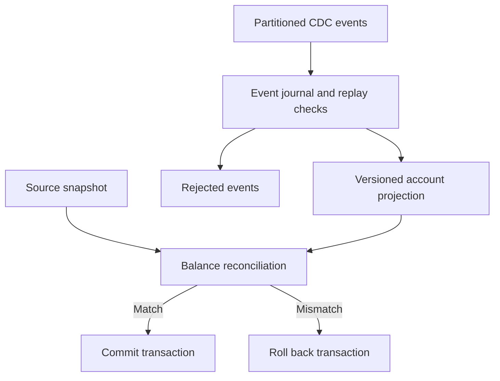

# Banking CDC and Reconciliation

A synthetic account-balance pipeline that applies change data capture (CDC) events and reconciles the result against an independent source snapshot. It demonstrates reliability controls for banking ingestion and warehouse loads.



## Run the demo

1. Install Python 3.10 or newer. Clone the repository and open a terminal at the repository root. There are no third-party dependencies.
2. Start with a fresh database and load the sample.

   ```sh
   python pipeline.py
   ```

   Expect three applied, one stale, one rejected and zero replayed. The active account balance is 1,800 cents. Account B is held as a tombstone after deletion.
3. Run the same command again. Expect five replayed events and zero new writes to the projection.
4. Inspect the target and rejects.

   ```sh
   python -c "import sqlite3; db=sqlite3.connect('output/cdc.db'); print(db.execute('SELECT * FROM accounts ORDER BY account_id').fetchall()); print(db.execute('SELECT * FROM rejected').fetchall())"
   ```

5. Run the regression test.

   ```sh
   python -m unittest discover -s tests -v
   ```

## Design and recovery

Each event has a unique partition and offset and carries a full after-image or a delete. An upstream monotonic version per account decides which change wins, even when events arrive out of order. A delete keeps its version so stale updates cannot resurrect the account. The test injects a late update after deletion, an incorrect snapshot and conflicting content at an already consumed offset.

Use a source snapshot taken at the same logical cutoff as the batch. On reconciliation failure, correct the snapshot or examine the source batch and rerun. The journal, rejects and projection all roll back together. Corrected quarantined records need a new source offset. Journal data contains synthetic payloads. A production design would restrict access and set retention for raw payloads, store an offset watermark per source partition, and stage before merging into a warehouse such as BigQuery. SQLite keeps this demo runnable on one machine.
